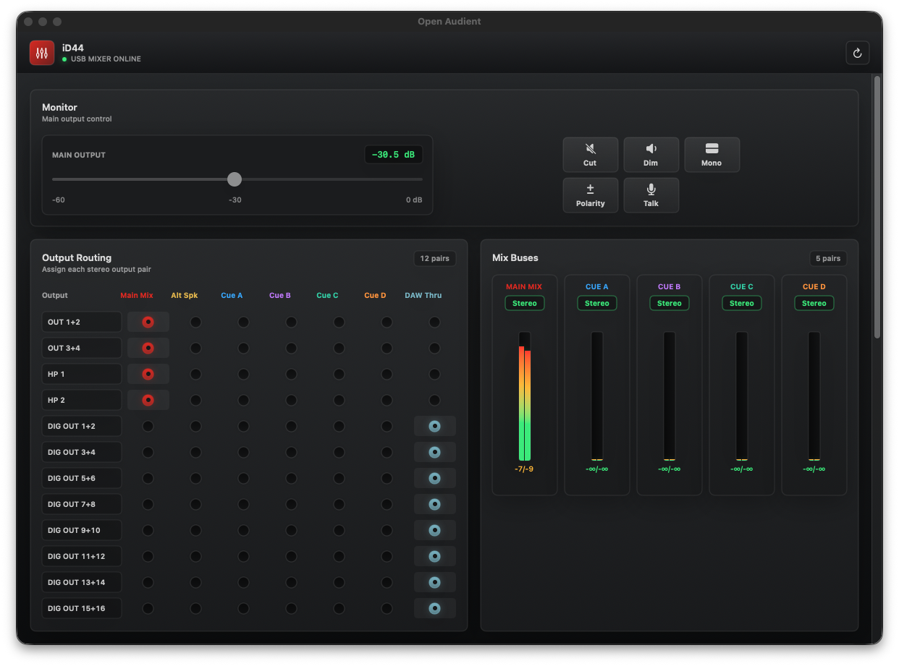

# OpenAudient

A native macOS mixer for the USB audio interfaces by Audient, written in Swift. It talks to the interfaces over USB directly, so Audient's iD app doesn't have to be installed or running.



The iD44 has a DSP mixer and a monitor controller built in, and normally you set both up with Audient's iD app. OpenAudient sends the same USB Audio Class control requests that app does. Audio itself still goes through the USB audio driver that ships with macOS, so playback and recording work exactly as before.

## What it does

- Main output level, with Cut, Dim, Mono, Polarity and Talkback.
- Routing for all 12 stereo output pairs on the iD44: the line outputs, both headphone outputs and the 16 ADAT channels. Each pair can play the main mix, the alt speaker feed, one of the four cue mixes or plain DAW playback.
- Send faders for every analog and ADAT input and for DAW playback 1+2 and 3+4, on the main mix and on the cue mixes. Main mix sends also get mute and solo.
- Meters on every input and every mix bus. DAW playback has meters on its first four channels.
- It sits in the menu bar and reconnects on its own when the iD44 is plugged back in.

## Status

Only the original iD44 has been tested. The code recognizes the rest of the iD range by USB product ID, but none of those models have been tried.

Quit Audient's iD app before opening OpenAudient. Only one program can hold the iD44's control interface at a time, and while the app is open that includes the `oa` command-line tool.

## Running it

You need macOS 13 or later and Xcode or a Swift toolchain.

```sh
./scripts/build-install-launch.sh
```

The script builds a release version, installs OpenAudient.app in `~/Applications` and opens it. To run it straight from the checkout instead, use `swift run oa`.

## Command line

Give the same binary a command and it runs without a window:

```sh
swift run oa cut toggle   # speaker mute, good for a keyboard shortcut
swift run oa routes       # where each output pair is routed
swift run oa meters       # input meters in the terminal
```

`oa help` lists the rest, including the raw get and set commands used to map the protocol. Those can send the iD44 requests it doesn't expect, and a bad read can lock up its control interface until you power-cycle it. The USB addresses and reverse-engineering notes are in [PROTOCOL.md](PROTOCOL.md).

## Legal

OpenAudient is an independent project. It isn't affiliated with or endorsed by Audient, and Audient and iD are Audient's trademarks. There's no license file yet.
